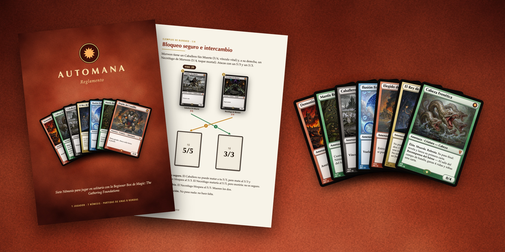
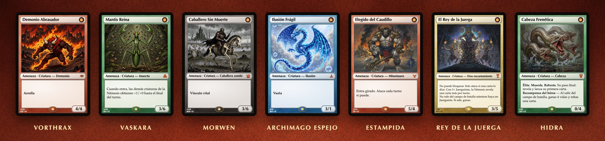
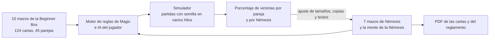
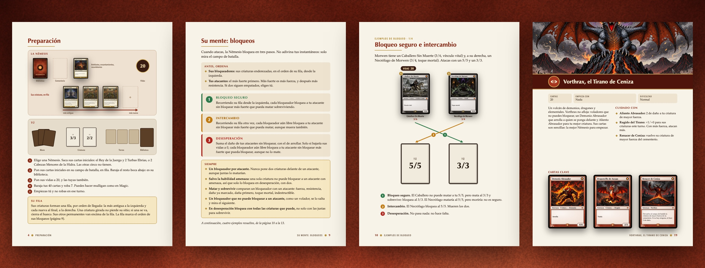

<p align="right"><a href="README.md">English</a> · <b>Español</b></p>

<p align="center">
  
</p>

<h1 align="center">Automana</h1>

<p align="center">
  <b>Siete mazos de Némesis que se juegan solos, para jugar en solitario con la Beginner Box de Magic: The Gathering Foundations.</b><br>
  Equilibrados con un simulador de las reglas de Magic. Cartas y reglamento para imprimir, en español y en inglés.
</p>

<p align="center">
  <a href="https://github.com/streetclips/automana/releases/latest/download/automana-rulebook-es.pdf"></a>
  <a href="https://github.com/streetclips/automana/releases/latest/download/automana-rulebook-en.pdf"></a>
  <br>
  <a href="https://github.com/streetclips/automana/releases/latest/download/automana-box-pnp-es.pdf"></a>
  <a href="https://github.com/streetclips/automana/releases/latest/download/automana-box-pnp-en.pdf"></a>
</p>

## Cómo se juega

Barajas juntos dos de los diez mazos de la Beginner Box y juegas a Magic como siempre. Al otro lado de la mesa está la Némesis: un mazo sin mano, sin tierras y sin maná. Cada turno revela su primera carta y la lanza gratis; después ataca y bloquea con unas pocas reglas públicas, su mente, que tú ejecutas por ella. Baja sus 20 vidas a 0 antes de que ella te lo haga a ti.

1. **Siete Némesis**, desde un tirano volcánico hasta una hidra a la que le vuelven a crecer las cabezas. Cuatro son propias de Automana; tres se inspiran en los Challenge Decks que Wizards of the Coast hizo para Theros.
2. **Solo tienes que aprender su mente.** Ataca con cada criatura que no puedes parar y bloquea en tres pasos fijos, así que siempre sabes qué hará.
3. **Lista para imprimir.** 208 cartas y un reglamento A5 de 28 páginas, maquetados para una imprenta. Aparte de eso, solo necesitas la Beginner Box.

<p align="center">
  
</p>

| Némesis | Cartas | Su juego |
|---|---:|---|
| Vorthrax, el Tirano de Ceniza | 20 | Demonios, dragones y fuego para tu mejor criatura |
| Vaskara, la Madre Enjambre | 20 | Un enjambre de insectos que te cierra el paso y no deja de crecer |
| Morwen, la Reina Liche | 20 | No muertos que vuelven, y vínculo vital que la cura |
| El Archimago Espejo | 20 | Contraconjuros, rebotes y voladores frágiles |
| La Estampida | 43 | Minotauros con prisa que atacan cada turno |
| El Rey de la Juerga | 46 | Un dios que no puede bloquear y Juerguistas que atacan a sus órdenes; si él sale, ganas |
| La Hidra | 38 | Cabezas que muerden cada turno y vuelven a crecer al morir |

## El simulador

El equilibrio de Automana no es a ojo. Bajo las cartas hay un motor completo de las reglas de Magic con los diez mazos de la Beginner Box, una IA que juega por ti y el asiento de la Némesis. El simulador enfrenta cada pareja de mazos de la caja a cada Némesis, miles de veces, y cada Némesis se ajustó hasta que su resultado dio en un objetivo.



1. **La caja de verdad.** El motor juega las 124 cartas distintas de los diez mazos, tierras incluidas. `npm run box:cards` compara sus textos con el oráculo de Scryfall, y [`docs/box.md`](docs/box.md) recoge las pocas aproximaciones y hacia dónde mueve cada una el porcentaje de victorias.
2. **Un jugador que piensa.** La IA predice los bloqueos de la Némesis con las mismas reglas públicas, usa sus trucos de combate y juega el turno de la Némesis por adelantado antes de elegir sus ataques y sus hechizos. Decide sobre una copia de la biblioteca de la Némesis barajada de nuevo, así que nunca conoce la carta siguiente.
3. **La Némesis tal como se imprime.** La misma mente y los mismos textos que el reglamento. Los ejemplos de combate del reglamento se juegan en el motor cada vez que se genera, y la generación se para si uno deja de coincidir.
4. **Todos los emparejamientos, reproducibles.** 45 parejas de mazos contra 7 Némesis en varios hilos, con una semilla por partida: la misma semilla da las mismas partidas con cualquier número de hilos.
5. **Con tests.** 72 tests de escenarios: las cartas de la caja (38), las reglas de la Némesis (26) y las cartas de los Challenge Decks (8).

Los objetivos y los resultados, sobre 1800 partidas por Némesis (semillas 1, 3, 5 y 7, ±2,3 puntos):

| Némesis | Objetivo para el jugador | Gana el jugador | Rondas por partida |
|---|---:|---:|---:|
| Vorthrax | 52–58 % | 55,3 % | 8,0 |
| Vaskara | 52–58 % | 55,6 % | 8,3 |
| Morwen | 42–48 % | 46,1 % | 8,9 |
| El Archimago Espejo | 42–48 % | 44,8 % | 8,9 |
| La Estampida | 45–55 % | 46,6 % | 7,2 |
| El Rey de la Juerga | 45–55 % | 54,4 % | 7,0 |
| La Hidra | 45–55 % | 47,6 % | 7,4 |

Cómo llegó ahí cada Némesis, y lo que no funcionó, está en [`docs/box-nemesis.md`](docs/box-nemesis.md#tuning), en inglés.

### Ejecútalo

```sh
npm install
npm run box -- --games 10 --seed 1             # cada pareja de mazos contra cada Némesis
npm run box -- --games 100 --nemeses hydra     # una sola Némesis
npm run box:trace -- 1 cats+healing vorthrax   # una partida, turno a turno
```

`npm run box -- --games 4 --seed 1` es una tirada corta, de 4 partidas por pareja: 1260 partidas en 54 segundos en el Mac en el que se escribió este README. Imprime el porcentaje de victorias de cada pareja de mazos contra cada Némesis y después esta tabla, en inglés, y guarda las dos en `dist/box/`:

| Nemesis | Win rate | Rounds | Rounds (wins) | Player life (wins) | Nemesis life (losses) | Mulligans / game | Draws | Errors |
|---|---:|---:|---:|---:|---:|---:|---:|---:|
| Vorthrax | 54.4% | 7.9 | 8.3 | 9.2 | 14.7 | 0.22 | 0 | 0 |
| Vaskara | 57.2% | 8.2 | 8.8 | 7.5 | 18.6 | 0.17 | 0 | 0 |
| Morwen | 43.9% | 9.2 | 9.8 | 9.5 | 30.8 | 0.16 | 0 | 0 |
| Mirror Archmage | 50.6% | 8.9 | 10.1 | 10.9 | 15.6 | 0.18 | 0 | 0 |
| The Stampede | 43.3% | 7.0 | 7.8 | 10.3 | 15.0 | 0.14 | 0 | 0 |
| The Revel King | 55.6% | 6.9 | 7.6 | 11.3 | 16.0 | 0.18 | 0 | 0 |
| The Hydra | 46.7% | 7.4 | 8.3 | 8.9 | 13.9 | 0.19 | 0 | 0 |
| All | 50.2% | 7.9 | 8.7 | 9.6 | 18.0 | 0.18 | 0 | 0 |

Con 4 partidas por pareja los porcentajes se mueven varios puntos de una tirada a otra; los publicados usan 40.

Y un turno de una partida, de `npm run box:trace -- 1 cats+healing vorthrax`:

```
Turn 10 — the opponent's turn.
The opponent draws a card.
The opponent casts Vorthrax's Herald.
The opponent's Vorthrax's Herald triggers targeting you.
The opponent's Vorthrax's Herald deals 1 damage to you.
The opponent attacks with Scorch Fiend, Ember Wyrmling, and Cinderclaw Brute.
You block: Hinterland Sanctifier → Scorch Fiend, Leonin Skyhunter → Cinderclaw Brute.
The opponent's Scorch Fiend deals 2 damage to your Hinterland Sanctifier.
The opponent's Scorch Fiend deals 2 damage to you.
The opponent's Ember Wyrmling deals 2 damage to you.
The opponent's Cinderclaw Brute deals 3 damage to your Leonin Skyhunter.
Your Hinterland Sanctifier deals 1 damage to the opponent's Scorch Fiend.
Your Leonin Skyhunter deals 2 damage to the opponent's Cinderclaw Brute.
Your Leonin Skyhunter dies.
Your Hinterland Sanctifier dies.
```

`BOX_THREAT_SIZES`, `BOX_THREAT_COPIES` y `BOX_CHALLENGE` cambian los tamaños y las copias de cualquier Amenaza durante una tirada, para probar un cambio antes de tocar los mazos: mira [Tools](docs/box-nemesis.md#tools).

## Imprímelo

Descarga los PDF con los botones de arriba o genéralos tú. Los dos están maquetados para [Imprenta Soriano](https://imprentasoriano.com), una imprenta online española, en formatos estándar: hojas A4 de 9 cartas con marcas de corte, y páginas A5 con sangrado.

<p align="center">
  
</p>

### Las cartas

`npm run pnp` maqueta todas las cartas físicas (208: la carta de reglas y los siete mazos) para la baraja de póquer de Imprenta Soriano:

1. Páginas A4, 9 cartas por hoja (3 × 3), con marcas de corte en los márgenes: 24 hojas, 48 páginas.
2. Cartas de 63 × 88 mm con 3 mm de sangrado por lado (69 × 94 mm); el texto queda 3 mm dentro del corte.
3. Las páginas impares son anversos y las pares reversos, en espejo para imprimir a doble cara por el borde largo.
4. Esquinas rectas: pide la opción de cantos redondeados de 3 mm.
5. CMYK, convertido con Ghostscript.
6. Sin sombras difuminadas: algunos visores de PDF las dibujan como manchas oscuras sólidas sobre la carta.
7. Cada celda lleva debajo el negro del marco, así que las finas rendijas que deja la conversión a CMYK en el borde del marco salen negras, no blancas.
8. Las superficies con textura (marco, dorso, caja de texto y hueco de ilustración) son un PNG opaco por color, generado por `src/render/textures.ts`, en vez de degradados y modos de fusión de CSS: Ghostscript convierte cada degradado en una imagen de baja resolución, y Vista Previa de macOS dibujaba las capas fusionadas con costuras rectangulares.

Todas las cartas comparten el dorso de Amenaza; la carta de reglas muestra su Cara B.

Sube el PDF a [Baraja de Cartas](https://imprentasoriano.com/producto/baraja-de-cartas) y rellena el formulario así:

| Opción | Valor |
|---|---|
| ¿Quieres que la montemos nosotros? | No (ya están montadas) |
| Cantidad de páginas | 48 por juego: 24 hojas, por las dos caras |
| Numero de cartas por hoja | 9 |
| Grosor del papel | Especial para barajar cartas (300 g, Black Core) |
| Cortar | Sí |
| Cantos redondeados | Sí, 3 mm |

1. La cartulina Black Core está hecha para barajar y es opaca: la cara de la carta de arriba no se transparenta por su dorso.
2. Elige esquinas de 3 mm: las cartas tienen las esquinas rectas, y la imprenta solo aconseja 4 mm cuando el redondeo está impreso.
3. Varios juegos: multiplica las páginas por el número de juegos y escribe ese número en el campo Mostrador.
4. Los PDF en español y en inglés tienen el mismo corte, así que pueden ir en un solo pedido sin los 15 € de cada corte extra.
5. Un juego, 48 páginas, cortado, costó 33,27 € en Black Core y 34,68 € en la cartulina gofrada de 310 g el 16 de octubre de 2026, sin el envío. El formulario no tiene la opción de cantos redondeados; pídela en Mostrador. La imprenta no dice si el IVA está incluido.

### El reglamento

`npm run rulebook` genera `dist/automana-rulebook-en.pdf` y `-es.pdf`, un cuadernillo que enseña las reglas de la Némesis con las cartas de verdad: la preparación, los dos turnos, su mente, cuatro ejemplos de bloqueo, un turno paso a paso, un glosario, preguntas y respuestas, una página por Némesis, las listas de mazos y una referencia rápida.

1. 28 páginas A5 con 3 mm de sangrado (154 × 216 mm), sueltas y en orden de lectura, en CMYK: lo que Imprenta Soriano pide para las revistas. El texto y las cartas quedan al menos 6 mm dentro del corte; la imprenta pide 5.
2. El texto está en `src/content/rulebook.ts`, en `en` y `es`; los ejemplos, las ilustraciones y las cartas clave de cada Némesis, en `src/rulebook/data.ts`.
3. Cada ejemplo de combate se juega en el motor al generar el reglamento (`src/box/nemesis/examples.ts`). Si la mente de la Némesis deja de atacar, bloquear o elegir objetivos como muestra una página, la generación se para y dice qué ejemplo falla.
4. La generación maqueta primero las páginas en Chrome y se para si algún texto o figura se sale de los márgenes de su página.
5. El reglamento solo enseña las reglas: sin porcentajes de victoria, sin tamaños de mesa y sin consejos para ganar a una Némesis.

Sube el PDF a [Revistas y catálogos](https://imprentasoriano.com/producto/revistas-y-catalogos):

| Opción | Valor |
|---|---|
| Tamaño | A5 |
| Papel que quieres utilizar en el interior | 150 GRS. Estucado |
| Acabado | Mate |
| Impresión | Color: 28 |
| Cubiertas | Igual que el interior |

1. 28 páginas costaron 13,30 € el 24 de octubre de 2026, sin el envío.
2. Una cubierta aparte de 250 g con plastificado mate (Diferente del interior) subió un presupuesto de 24 páginas de 12,99 € a 37,67 €.

## Ejecútalo tú

| Comando | Qué genera |
|---|---|
| `npm run typecheck` | Comprueba los tipos de todo `src/` |
| `npm run box -- --games 100 --seed 1` | El porcentaje de victorias de cada pareja de mazos contra cada Némesis, en `dist/box/`; `--nemeses revel,hydra` y `--decks` filtran |
| `npm run box:trace -- 1 cats+healing revel` | Una partida, turno a turno |
| `npm run box:test`, `box:test:nemesis`, `box:test:challenges` | Tests de escenarios: cartas de la caja (38), reglas de la Némesis (26), cartas de los Challenge Decks (8) |
| `npm run box:cards` | Los textos de las cartas del motor comparados con el oráculo de Scryfall |
| `npm run preview` | Vista previa de las cartas en `http://localhost:4400`, que se recarga al guardar |
| `npm run pnp` | `dist/automana-box-pnp-en.pdf` y `-es.pdf`: las cartas, para [Imprenta Soriano](https://imprentasoriano.com/producto/baraja-de-cartas) |
| `npm run rulebook` | `dist/automana-rulebook-en.pdf` y `-es.pdf`: el reglamento A5 de 28 páginas, para [Imprenta Soriano](https://imprentasoriano.com/producto/revistas-y-catalogos) |
| `npm run build` | `typecheck` y después `pnp` y `rulebook` |
| `npm run art` | `art/{id de carta}.jpg`: ilustraciones con IA para las cartas que tienen escena y aún no tienen imagen. `npm run art -- nm_brood nm_uprising` regenera esas cartas |
| `npm run readme:images` | `docs/images/*-en.jpg` y `*-es.jpg`: las imágenes de `README.md` y de este README, renderizadas a partir de las cartas y del reglamento |

Requisitos: Node 22+. `npm run pnp`, `npm run rulebook`, `npm run build` y `npm run readme:images` también necesitan Google Chrome y Ghostscript (`brew install ghostscript`); cambia sus rutas con `CHROME_PATH` y `GS_PATH`. Las cartas y el reglamento usan fuentes de macOS: Optima, Palatino y Avenir Next. `npm run art` necesita `OPENROUTER_API_KEY`; ese comando y `npm run readme:images` usan `sips` de macOS para los JPEG.

### Publicar los PDF

Los botones de descarga apuntan a la última release de GitHub, así que una release nueva los sustituye:

```sh
npm run build
gh release create v0.3.0 dist/automana-rulebook-*.pdf dist/automana-box-pnp-*.pdf --title "Automana 0.3.0"
```

## Vista previa de las cartas

`npm run preview` sirve las cartas en `http://localhost:4400` (`PORT` lo cambia), renderizadas desde `src/` en cada petición:

1. `cards` muestra cada carta una vez, con una sección por componente: la carta de reglas, el dorso y los siete mazos de Némesis, con el id de cada carta y su número de copias debajo: `nm_ash_imp ×2`.
2. `pnp` muestra las hojas A4 de `npm run pnp`, anversos y reversos, sin Chrome ni Ghostscript: los colores son RGB, antes de la conversión a CMYK.
3. `rulebook` muestra las 28 páginas de `npm run rulebook`, también en RGB.
4. `en` y `es` cambian el idioma y conservan la posición de la página.
5. Al guardar se recarga la página. Un cambio en `src/content/` o en el código de renderizado reinicia el servidor; un cambio de CSS o una imagen nueva en `art/` solo recarga la página.
6. Un error de renderizado muestra su traza en la página, que se recarga en cuanto lo arreglas.

## El marco de las cartas

Cada carta usa el marco moderno de Magic en el color de su Némesis, como si fuera un color de maná:

| Color | Némesis |
|---|---|
| Rojo | Vorthrax, la Estampida |
| Verde | Vaskara, la Hidra |
| Negro | Morwen |
| Azul | el Archimago Espejo |
| Dorado | el Rey de la Juerga |

1. El marco está en `src/render/card.css`; el color y el código de cada colección, en `SETS` de `src/render/card.ts`, y la paleta y las texturas de cada color, en `PALETTES` de `src/render/textures.ts`.
2. Bajo la caja de texto: el número de colección, el código de la colección y el idioma, `12/20` y `VOR • ES`, junto a un sello holográfico con el estallido de Amenaza.
3. Los nombres y las líneas de tipo se encogen según su longitud para caber en su barra; los textos de reglas largos se encogen un poco.
4. La carta de reglas usa el mismo marco en gris.

## Ilustraciones

`npm run art` ilustra las cartas con [Hy Image 3.5 Preview](https://openrouter.ai/tencent/hy-image-v3.5-preview) a través de OpenRouter, de 4 en 4, unos 13 s por imagen:

1. Una carta con ilustración describe su escena en su campo `art`, por ejemplo `art: "a swarm of insect hatchlings bursting out of a cluster of glowing eggs in a dark hive chamber"`. Todas las cartas de los siete mazos tienen una; en `src/content/challenges.ts` es el último argumento de `card()`.
2. `src/art/generate.ts` la envuelve en el estilo común: `Art illustration in the old Magic: The Gathering style of {art}, like a classic {type} card. No border, frame or text.`
3. Sin referencias de estilo: si recibe otras cartas de su mazo, Hy Image repinta su personaje, su pose y su ropa en vez de tomar solo su estilo. Con `REFERENCES` mayor que 0, las ilustraciones de las primeras cartas de su mazo de Némesis acompañan al prompt, que entonces pide igualar su estilo de pintura, su paleta y su nivel de detalle; los mazos de Automana se hicieron así, con 3, en Gemini.
4. Hy Image devuelve PNG de 1024 × 816; el script los convierte a JPEG con calidad 80 con `sips` de macOS, unos 320 KB cada uno, en `art/`, con el id de la carta como nombre. Súbelos al repo: una nueva tirada da otra imagen. Las imágenes de los mazos de Automana son de 1152 × 928, de Gemini 3.1 Flash Lite Image, o de 1088 × 960, de Ming Image 0.1 Design, que OpenRouter ya no ofrece; el marco de la carta recorta cualquier tamaño para que encaje.
5. Cada imagen costó 0,024 $ el 16 de octubre de 2026, frente a 0,034 $ con Gemini. El script imprime el coste de cada imagen y el total. Las 44 imágenes de los Challenge Decks necesitaron 67 generaciones, 1,61 $.
6. La vista previa y los PDF muestran `art/{id}.jpg` cuando existe y, si no, el símbolo del mazo sobre el color de su marco.
7. Mira cada imagen nueva y regenera las que tengan borde, texto, desnudos o la escena equivocada: `npm run art -- {id}`. Hy Image pinta desnudas las figuras de la mitología griega (ménades, ninfas, héroes) salvo que la escena las vista, pinta minotauros con cara humana salvo que sean «bull-headed» y sátiros sin patas de cabra salvo que sean «goat-legged».

## Estructura

La documentación técnica está en inglés: [`docs/box.md`](docs/box.md), los mazos de la Beginner Box en el motor y sus aproximaciones, y [`docs/box-nemesis.md`](docs/box-nemesis.md), el asiento de la Némesis: reglas, mente, los siete mazos, el ajuste y la IA del jugador.

```
docs/box.md             los mazos de la Beginner Box en el motor y sus aproximaciones
docs/box-nemesis.md     el asiento de la Némesis: reglas, mente, los siete mazos, ajuste, la IA del jugador
docs/images/            las imágenes de los dos README, en cada idioma
art/                    ilustraciones de las cartas, un {id de carta}.jpg cada una
src/
├── box/                motor de Magic e IA (de mana-duel), los 10 mazos de la caja, el asiento de la Némesis y su simulador
│   ├── engine/         motor de reglas, el turno de la Némesis y los efectos de las cartas de los Challenge Decks
│   ├── ai/             IA del jugador
│   └── nemesis/        los siete mazos de Némesis, su mente, el simulador, sus tests y los ejemplos del reglamento
├── content/            datos impresos de las cartas, bilingües (en/es), sin renderizado
│   ├── threats.ts      nombres, textos y escenas de los cuatro mazos de Automana
│   ├── challenges.ts   nombres, textos y escenas de los tres Challenge Decks
│   ├── box-reference.ts la carta de reglas
│   ├── rulebook.ts     el texto del reglamento
│   └── index.ts        catálogo: PRINTED_CARDS, DECK_NAMES, getPrintedCard(id)
├── i18n/               textos de la interfaz por idioma + idioma actual
├── render/             componentes HTML: card.ts (cartas y dorso), faces.ts (la carta de reglas de dos caras), art.ts (ilustraciones), icons.ts (estallido de Amenaza y símbolos de colección), textures.ts (paletas de los marcos, y su grano, moteado y degradados generados como PNG)
├── preview/            sirve la vista previa de las cartas: páginas y servidor web
├── pnp/                genera los PDF de las cartas: box.ts (la baraja), imposition.ts (hojas A4), pdf.ts (Chrome y Ghostscript)
├── rulebook/           genera el reglamento: pages.ts (sus 28 páginas), diagrams.ts (cartas y figuras de combate), data.ts (ejemplos, ilustraciones, cartas clave), build.ts (comprobación de maquetación y PDF)
├── readme/             renderiza las imágenes de los README
├── art/                genera las ilustraciones de las cartas con OpenRouter
└── lib/                utilidades del sistema de archivos
```

## Cambiar el contenido

1. Las reglas y los tamaños viven en el motor: `src/box/nemesis/threats.ts` y `src/box/nemesis/challenges.ts`. Los nombres y textos impresos viven en `src/content/`, con el mismo id de carta, en `en` y en `es`.
2. Compruébalo en `npm run preview` y ejecuta `npm run typecheck`.
3. Ejecuta las tres suites `box:test` y después `npm run box -- --nemeses {id}` para comprobar el porcentaje de victorias contra su objetivo en `docs/box-nemesis.md`.
4. Ejecuta `npm run build` cuando necesites PDF nuevos, y `npm run readme:images` cuando cambien las cartas que salen en los README.

## Créditos y aviso legal

1. Automana is unofficial Fan Content permitted under the [Fan Content Policy](https://company.wizards.com/en/legal/fancontentpolicy). Not approved/endorsed by Wizards. Portions of the materials used are property of Wizards of the Coast. ©Wizards of the Coast LLC. En español: Automana es contenido de fans no oficial, permitido por la Fan Content Policy. No está aprobado ni respaldado por Wizards. Partes de los materiales usados son propiedad de Wizards of the Coast.
2. Para jugar necesitas la Beginner Box de Magic: The Gathering Foundations: Automana solo imprime sus propias cartas de Némesis.
3. La Estampida, el Rey de la Juerga y la Hidra se inspiran en los Challenge Decks de Theros de Wizards of the Coast.
4. Las ilustraciones de las cartas se hicieron con modelos de imagen de IA; mira [Ilustraciones](#ilustraciones).
