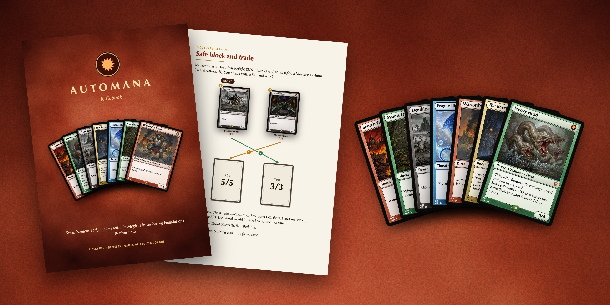
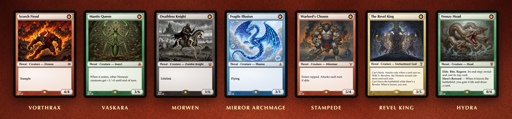
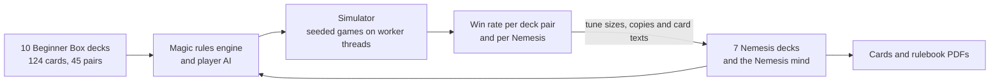
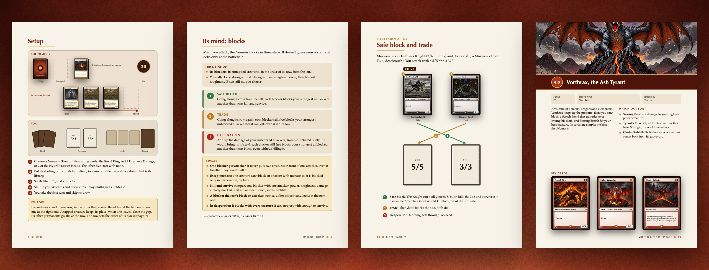

<p align="right"><b>English</b> · <a href="README.es.md">Español</a></p>

<p align="center">
  
</p>

<h1 align="center">Automana</h1>

<p align="center">
  <b>Seven Nemesis decks that play themselves, so you can play the Magic: The Gathering Foundations Beginner Box alone.</b><br>
  Balanced on a Magic rules simulator. Print-and-play cards and rulebook, in English and Spanish.
</p>

<p align="center">
  <a href="https://github.com/streetclips/automana/releases/latest/download/automana-rulebook-en.pdf"></a>
  <a href="https://github.com/streetclips/automana/releases/latest/download/automana-rulebook-es.pdf"></a>
  <br>
  <a href="https://github.com/streetclips/automana/releases/latest/download/automana-box-pnp-en.pdf"></a>
  <a href="https://github.com/streetclips/automana/releases/latest/download/automana-box-pnp-es.pdf"></a>
</p>

## How it plays

You shuffle two of the ten Beginner Box decks together and play Magic as usual. Across the table sits a Nemesis: a deck with no hand, no lands and no mana. Each turn it reveals its top card and casts it for free, then attacks and blocks by a few public rules, its mind, that you run for it. Bring its 20 life to 0 before it does the same to you.

1. **Seven Nemeses**, from a volcano tyrant to a hydra whose heads grow back. Four are Automana's own; three are inspired by the Challenge Decks that Wizards of the Coast made for Theros.
2. **Nothing to learn but its mind.** It attacks with every creature you can't stop and blocks in three fixed steps, so you always know what it will do.
3. **Ready to print.** 208 cards and a 28-page A5 rulebook, laid out for a print shop. Besides them, you only need the Beginner Box.

<p align="center">
  
</p>

| Nemesis | Cards | Its game |
|---|---:|---|
| Vorthrax, the Ash Tyrant | 20 | Demons, dragons and fire for your best creature |
| Vaskara, the Brood Mother | 20 | An insect swarm that walls you in and keeps growing |
| Morwen, the Lich Queen | 20 | Undead that come back, and lifelink that heals her |
| The Mirror Archmage | 20 | Counterspells, bounce and fragile fliers |
| The Stampede | 43 | Minotaurs with haste that attack every turn |
| The Revel King | 46 | A god who can't block and Revelers who attack on his orders; make him leave and you win |
| The Hydra | 38 | Heads that bite every turn and grow back when they die |

## The simulator

Automana's balance isn't guessed. Under the cards sits a complete Magic rules engine with the ten Beginner Box decks, a player AI and the Nemesis seat. The simulator plays every pair of box decks against every Nemesis, thousands of times, and each Nemesis was tuned until its result hit a target.



1. **The real box.** The engine plays all 124 different cards of the ten decks, lands included. `npm run box:cards` compares their texts with Scryfall's oracle, and [`docs/box.md`](docs/box.md) lists the few approximations and which way each one moves the win rate.
2. **A player that thinks.** The AI predicts the Nemesis's blocks with the same public rules, uses its combat tricks, and plays out the Nemesis turn before it chooses its attacks and spells. It decides on a reshuffled copy of the Nemesis library, so it never knows the next card.
3. **The Nemesis as printed.** The same mind and card texts as the rulebook. The rulebook's combat examples run on the engine every time it is built, and the build stops if one stops matching.
4. **Every pairing, reproducible.** 45 deck pairs against 7 Nemeses on worker threads, with a seed per game: the same seed gives the same games on any number of workers.
5. **Tested.** 72 scenario tests: the box cards (38), the Nemesis rules (26) and the Challenge deck cards (8).

The targets and the results, over 1,800 games per Nemesis (seeds 1, 3, 5 and 7, ±2.3 points):

| Nemesis | Target for the player | Player wins | Rounds per game |
|---|---:|---:|---:|
| Vorthrax | 52–58% | 55.3% | 8.0 |
| Vaskara | 52–58% | 55.6% | 8.3 |
| Morwen | 42–48% | 46.1% | 8.9 |
| The Mirror Archmage | 42–48% | 44.8% | 8.9 |
| The Stampede | 45–55% | 46.6% | 7.2 |
| The Revel King | 45–55% | 54.4% | 7.0 |
| The Hydra | 45–55% | 47.6% | 7.4 |

How each Nemesis got there, and what didn't work, is in [`docs/box-nemesis.md`](docs/box-nemesis.md#tuning).

### Run it

```sh
npm install
npm run box -- --games 10 --seed 1             # every deck pair against every Nemesis
npm run box -- --games 100 --nemeses hydra     # one Nemesis
npm run box:trace -- 1 cats+healing vorthrax   # one game, turn by turn
```

`npm run box -- --games 4 --seed 1` is a short run, 4 games per pair: 1,260 games in 54 seconds on the Mac this README was written on. It prints the win rate of every deck pair against every Nemesis, then this table, and writes both to `dist/box/`:

| Nemesis | Win rate | Rounds | Rounds (wins) | Player life (wins) | Nemesis life (losses) | Mulligans / game | Draws | Errors |
|---|---:|---:|---:|---:|---:|---:|---:|---:|
| Vorthrax | 54.4% | 7.9 | 8.3 | 9.2 | 14.7 | 0.22 | 0 | 0 |
| Vaskara | 57.2% | 8.2 | 8.8 | 7.5 | 18.6 | 0.17 | 0 | 0 |
| Morwen | 43.9% | 9.2 | 9.8 | 9.5 | 30.8 | 0.16 | 0 | 0 |
| Mirror Archmage | 50.6% | 8.9 | 10.1 | 10.9 | 15.6 | 0.18 | 0 | 0 |
| The Stampede | 43.3% | 7.0 | 7.8 | 10.3 | 15.0 | 0.14 | 0 | 0 |
| The Revel King | 55.6% | 6.9 | 7.6 | 11.3 | 16.0 | 0.18 | 0 | 0 |
| The Hydra | 46.7% | 7.4 | 8.3 | 8.9 | 13.9 | 0.19 | 0 | 0 |
| All | 50.2% | 7.9 | 8.7 | 9.6 | 18.0 | 0.18 | 0 | 0 |

With 4 games per pair the rates move several points from run to run; the published ones use 40.

And a turn of one game, from `npm run box:trace -- 1 cats+healing vorthrax`:

```
Turn 10 — the opponent's turn.
The opponent draws a card.
The opponent casts Vorthrax's Herald.
The opponent's Vorthrax's Herald triggers targeting you.
The opponent's Vorthrax's Herald deals 1 damage to you.
The opponent attacks with Scorch Fiend, Ember Wyrmling, and Cinderclaw Brute.
You block: Hinterland Sanctifier → Scorch Fiend, Leonin Skyhunter → Cinderclaw Brute.
The opponent's Scorch Fiend deals 2 damage to your Hinterland Sanctifier.
The opponent's Scorch Fiend deals 2 damage to you.
The opponent's Ember Wyrmling deals 2 damage to you.
The opponent's Cinderclaw Brute deals 3 damage to your Leonin Skyhunter.
Your Hinterland Sanctifier deals 1 damage to the opponent's Scorch Fiend.
Your Leonin Skyhunter deals 2 damage to the opponent's Cinderclaw Brute.
Your Leonin Skyhunter dies.
Your Hinterland Sanctifier dies.
```

`BOX_THREAT_SIZES`, `BOX_THREAT_COPIES` and `BOX_CHALLENGE` change the sizes and copies of any Threat for one run, to try a change before editing the decks: see [Tools](docs/box-nemesis.md#tools).

## Print it

Download the PDFs with the buttons at the top, or build them yourself. Both are laid out for [Imprenta Soriano](https://imprentasoriano.com), a Spanish online print shop, in standard formats: A4 sheets of 9 cards with crop marks, and A5 pages with bleed.

<p align="center">
  
</p>

### The cards

`npm run pnp` lays out every physical card (208: the rules card and the seven decks) for Imprenta Soriano's poker deck:

1. A4 pages, 9 cards per sheet (3 × 3), crop marks in the margins: 24 sheets, 48 pages.
2. Cards at 63 × 88 mm with 3 mm bleed per side (69 × 94 mm); text kept 3 mm inside the cut.
3. Odd pages are fronts, even pages are backs, mirrored for long-edge duplex.
4. Square corners: order the 3 mm rounded corners option instead.
5. CMYK, converted with Ghostscript.
6. No blurred shadows: some PDF viewers draw them as solid dark patches over the card.
7. Each cell is frame black underneath, so the hairline gaps the CMYK conversion leaves at the frame edge print black, not white.
8. The textured surfaces (frame, back, text box and art placeholder) are one opaque PNG per colour, baked by `src/render/textures.ts`, not CSS gradients and blend modes: Ghostscript turns each gradient into a low-resolution image, and macOS Preview drew the blended layers with rectangular seams.

Every card shares the Threat back; the rules card shows its Face B.

Upload the PDF to [Baraja de Cartas](https://imprentasoriano.com/producto/baraja-de-cartas) and fill in the form like this:

| Option | Value |
|---|---|
| ¿Quieres que la montemos nosotros? | No (ya están montadas) |
| Cantidad de páginas | 48 per set: 24 sheets, front and back |
| Numero de cartas por hoja | 9 |
| Grosor del papel | Especial para barajar cartas (300 g, Black Core) |
| Cortar | Sí |
| Cantos redondeados | Sí, 3 mm |

1. Black Core card is made for shuffling and is opaque: the face of the top card does not show through its back.
2. Take 3 mm corners: the cards have square corners, and the shop advises 4 mm only when the rounding is printed.
3. Several sets: multiply the pages by the number of sets and write the number of sets in the Mostrador field.
4. The English and Spanish PDFs have the same cut, so they can go in one order without the 15 € fee for each extra cut.
5. One set, 48 pages, cut, cost 33.27 € on Black Core card and 34.68 € on the 310 g embossed card on 16 October 2026, shipping not included. The form has no rounded corners option; ask for them in Mostrador. The shop does not say whether VAT is included.

### The rulebook

`npm run rulebook` writes `dist/automana-rulebook-en.pdf` and `-es.pdf`, a booklet that teaches the Nemesis rules with the real cards: setup, both turns, its mind, four block examples, a turn step by step, a glossary, questions and answers, a page per Nemesis, the deck lists and a quick reference.

1. 28 A5 pages with 3 mm bleed (154 × 216 mm), single pages in reading order, CMYK: what Imprenta Soriano asks for magazines. Text and cards stay at least 6 mm inside the cut; the shop asks for 5.
2. The text is in `src/content/rulebook.ts`, in `en` and `es`; the examples, the illustrations and each Nemesis's key cards in `src/rulebook/data.ts`.
3. Every combat example is played on the engine as the rulebook is built (`src/box/nemesis/examples.ts`). If the Nemesis mind no longer attacks, blocks or targets as a page shows, the build stops and names the example.
4. The build lays the pages out in Chrome first and stops if any text or figure runs past its page's margins.
5. The rulebook teaches the rules only: no win rates, no board sizes and no tips on how to beat a Nemesis.

Upload the PDF to [Revistas y catálogos](https://imprentasoriano.com/producto/revistas-y-catalogos):

| Option | Value |
|---|---|
| Tamaño | A5 |
| Papel que quieres utilizar en el interior | 150 GRS. Estucado |
| Acabado | Mate |
| Impresión | Color: 28 |
| Cubiertas | Igual que el interior |

1. 28 pages cost 13.30 € on 24 October 2026, shipping not included.
2. A separate 250 g cover with matte lamination (Diferente del interior) took a 24-page quote from 12.99 € to 37.67 €.

## Build it yourself

| Command | Output |
|---|---|
| `npm run typecheck` | Type-checks everything in `src/` |
| `npm run box -- --games 100 --seed 1` | Win rates of every box deck pair against every Nemesis, in `dist/box/`; `--nemeses revel,hydra` and `--decks` filter |
| `npm run box:trace -- 1 cats+healing revel` | One game, turn by turn |
| `npm run box:test`, `box:test:nemesis`, `box:test:challenges` | Scenario tests: box cards (38), Nemesis rules (26), Challenge deck cards (8) |
| `npm run box:cards` | Engine card texts compared with Scryfall's oracle |
| `npm run preview` | Card preview at `http://localhost:4400`, reloaded on every save |
| `npm run pnp` | `dist/automana-box-pnp-en.pdf` and `-es.pdf`: the cards, for [Imprenta Soriano](https://imprentasoriano.com/producto/baraja-de-cartas) |
| `npm run rulebook` | `dist/automana-rulebook-en.pdf` and `-es.pdf`: the 28-page A5 rulebook, for [Imprenta Soriano](https://imprentasoriano.com/producto/revistas-y-catalogos) |
| `npm run build` | `typecheck`, then `pnp` and `rulebook` |
| `npm run art` | `art/{card id}.jpg`: AI illustrations for the cards with an art scene and no image yet. `npm run art -- nm_brood nm_uprising` regenerates those cards |
| `npm run readme:images` | `docs/images/*-en.jpg` and `*-es.jpg`: the pictures of this README and of `README.es.md`, rendered from the cards and the rulebook |

Requirements: Node 22+. `npm run pnp`, `npm run rulebook`, `npm run build` and `npm run readme:images` also need Google Chrome and Ghostscript (`brew install ghostscript`); override their paths with `CHROME_PATH` and `GS_PATH`. The cards and the rulebook use macOS fonts: Optima, Palatino and Avenir Next. `npm run art` needs `OPENROUTER_API_KEY`; it and `npm run readme:images` use macOS's `sips` for JPEGs.

### Releasing the PDFs

The download buttons point at the latest GitHub release, so a new release replaces them:

```sh
npm run build
gh release create v0.3.0 dist/automana-rulebook-*.pdf dist/automana-box-pnp-*.pdf --title "Automana 0.3.0"
```

## Card preview

`npm run preview` serves the cards at `http://localhost:4400` (`PORT` changes it), rendered from `src/` on every request:

1. `cards` shows every card once, one section per component: the rules card, the back and the seven Nemesis decks, with each card's id and number of copies under it: `nm_ash_imp ×2`.
2. `pnp` shows the A4 sheets of `npm run pnp`, fronts and backs, without Chrome or Ghostscript: colours are RGB, before the CMYK conversion.
3. `rulebook` shows the 28 pages of `npm run rulebook`, also in RGB.
4. `en` and `es` switch the language and keep the scroll position.
5. Saving reloads the page. A change in `src/content/` or the render code restarts the server; a CSS change or a new image in `art/` only reloads the page.
6. A render error shows its stack trace in the page, which reloads once you fix it.

## Card frame

Every card uses the modern Magic frame in its Nemesis's colour, as if it were a mana colour:

| Colour | Nemeses |
|---|---|
| Red | Vorthrax, the Stampede |
| Green | Vaskara, the Hydra |
| Black | Morwen |
| Blue | the Mirror Archmage |
| Gold | the Revel King |

1. The frame is in `src/render/card.css`; each set's colour and code are in `SETS` in `src/render/card.ts`, and each colour's palette and textures in `PALETTES` in `src/render/textures.ts`.
2. Under the text box: the collector number, the set code and the language, `12/20` and `VOR • EN`, next to a holo stamp with the Threat burst.
3. Names and type lines shrink with their length to fit their bar; long rules texts shrink a little.
4. The rules card uses the same frame in grey.

## Card art

`npm run art` illustrates cards with [Hy Image 3.5 Preview](https://openrouter.ai/tencent/hy-image-v3.5-preview) through OpenRouter, 4 at a time, about 13 s per image:

1. A card with an illustration describes its scene in its `art` field, for example `art: "a swarm of insect hatchlings bursting out of a cluster of glowing eggs in a dark hive chamber"`. Every card of the seven decks has one; in `src/content/challenges.ts` it is the last argument of `card()`.
2. `src/art/generate.ts` wraps it in the shared style: `Art illustration in the old Magic: The Gathering style of {art}, like a classic {type} card. No border, frame or text.`
3. No style references: given other cards of its deck, Hy Image repaints their character, pose and outfit instead of borrowing only their style. With `REFERENCES` above 0, the illustrations of the first cards of its Nemesis deck go with the prompt, which then asks to match their painting style, palette and level of detail; the Automana decks were made that way, with 3, on Gemini.
4. Hy Image returns 1024 × 816 PNGs; the script converts them to JPEG at quality 80 with macOS's `sips`, about 320 KB each, in `art/`, named by card id. Commit them: a new run gives a different image. The Automana decks' images are 1152 × 928, from Gemini 3.1 Flash Lite Image, or 1088 × 960, from Ming Image 0.1 Design, which OpenRouter no longer serves; the card frame crops every size to fit.
5. Each image cost $0.024 on 16 October 2026, against $0.034 with Gemini. The script prints the cost of every image and the total. The 44 Challenge deck images took 67 generations, $1.61.
6. The preview and the PDFs show `art/{id}.jpg` when it exists and the deck's symbol on its frame colour otherwise.
7. Look at every new image and regenerate any with a border, text, nudity or the wrong scene: `npm run art -- {id}`. Hy Image paints figures of Greek myth (maenads, nymphs, heroes) naked unless the scene dresses them, minotaurs with human faces unless they are "bull-headed" and satyrs without goat legs unless they are "goat-legged".

## Structure

```
docs/box.md             the Beginner Box decks in the engine and their approximations
docs/box-nemesis.md     the Nemesis seat: rules, mind, the seven decks, tuning, the player's AI
docs/images/            the pictures of this README and of README.es.md, in each language
art/                    card illustrations, one {card id}.jpg each
src/
├── box/                Magic engine and AI (from mana-duel), the 10 box decks, the Nemesis seat and its simulator
│   ├── engine/         rules engine, the Nemesis turn and the Challenge card effects
│   ├── ai/             player AI
│   └── nemesis/        the seven Nemesis decks, the Nemesis mind, the simulator, its tests and the rulebook's examples
├── content/            printed card data, bilingual (en/es), no rendering
│   ├── threats.ts      names, texts and art scenes of the four Automana decks
│   ├── challenges.ts   names, texts and art scenes of the three Challenge decks
│   ├── box-reference.ts the rules card
│   ├── rulebook.ts     the rulebook text
│   └── index.ts        catalog: PRINTED_CARDS, DECK_NAMES, getPrintedCard(id)
├── i18n/               UI strings per locale + current locale
├── render/             HTML components: card.ts (cards and their back), faces.ts (the two-face rules card), art.ts (illustrations), icons.ts (Threat burst and collection symbols), textures.ts (frame palettes, and their grain, mottle and gradients baked into PNGs)
├── preview/            serves the live card preview: pages and web server
├── pnp/                builds the print-and-play PDFs: box.ts (the deck), imposition.ts (A4 sheets), pdf.ts (Chrome and Ghostscript)
├── rulebook/           builds the rulebook: pages.ts (its 28 pages), diagrams.ts (cards and combat figures), data.ts (examples, illustrations, key cards), build.ts (layout check and PDF)
├── readme/             renders the pictures of this README
├── art/                generates the card illustrations with OpenRouter
└── lib/                filesystem helpers
```

## Changing content

1. Rules and sizes live in the engine: `src/box/nemesis/threats.ts` and `src/box/nemesis/challenges.ts`. Printed names and texts live in `src/content/`, keyed by the same card id, in both `en` and `es`.
2. Check it in `npm run preview` and run `npm run typecheck`.
3. Run the three `box:test` suites, then `npm run box -- --nemeses {id}` to check the win rate against its target in `docs/box-nemesis.md`.
4. Run `npm run build` when you need new PDFs, and `npm run readme:images` when the cards on this page change.

## Credits and legal

1. Automana is unofficial Fan Content permitted under the [Fan Content Policy](https://company.wizards.com/en/legal/fancontentpolicy). Not approved/endorsed by Wizards. Portions of the materials used are property of Wizards of the Coast. ©Wizards of the Coast LLC.
2. You need the Magic: The Gathering Foundations Beginner Box to play: Automana prints only its own Nemesis cards.
3. The Stampede, the Revel King and the Hydra are inspired by the Theros Challenge Decks by Wizards of the Coast.
4. The card illustrations were made with AI image models; see [Card art](#card-art).
